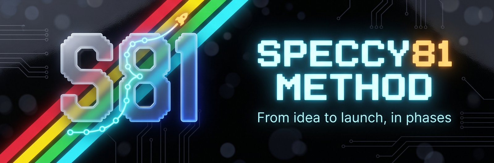

# Metoda Speccy81



**Od pomysłu do premiery.** Metoda Shania Webstudio™ (Speccy81) do zakładania każdego projektu — produktu, usługi, modułu czy aplikacji — z takim samym rygorem: najpierw badania, decyzje na podstawie danych, przekształcenie tego, czego się nauczysz, w zweryfikowaną wiedzę, jej audyt, projekt przed kodowaniem, testy terenowe i publikacja bez niespodzianek. Ma dwie edycje zbudowane z tej samej metody, każda jako marketplace pluginów Claude Code.

To jest **edycja podstawowa**: wolna i publiczna, ze skillem, krótkim przewodnikiem i 9 szablonami w każdym języku.

**Languages · Idiomas:** [English](README.md) · [Español](README.es.md) · [Català](README.ca.md) · [Nederlands](README.nl.md) · [Polski](README.pl.md) · [Português](README.pt.md) · [Français](README.fr.md) · [Italiano](README.it.md) · [Deutsch](README.de.md)

## Edycje

| | Podstawowa | Pełna |
|---|---|---|
| Licencja | Publiczna: CC BY 4.0 (przewodnik, SKILL i szablony) + MIT (skrypty); zobacz `NOTICE` | Własnościowa, Shania Webstudio™ |
| Ścieżka | Lekka ścieżka w pięciu krokach dla rozszerzeń i małych projektów | Fazy 0–9 oraz 8 bis i tryb lekki (C) dla projektów na 1–2 dni |
| Szablony | 9 (01, 06, 09, 10, 13, 15, 20, 21 i 26) | 27 |
| Złote zasady | 13, w skrócie, i 10 krótkich zasad zespołu | 13 w pełnej wersji, 10 krótkich zasad zespołu z załącznikami oraz usprawnienia wydajności E1–E15 |
| Badania i audyt | — | Równoległe fale badań i jeden audyt |
| Walidator wiedzy | — | Tak |
| Wdrożenie i premiera | — | Wdrożenie i QA na innym urządzeniu oraz publikacja |
| Zarządzanie i bezpieczeństwo | Zasada 13 w skrócie, „Dowód:” przy każdym wyniku, incydenty (20) i rozliczenie (21) | Dodatkowo: zarządzanie wieloma zespołami (19), przenoszenie sekretu, rotacja ujawnionego klucza, migracja danych (22), przekazanie lub zmiana maszyny (23) i lista kontrolna prywatności (24) |
| Kilka zespołów | Jedna sesja lub jeden zespół; do kilku sesji z minimalnymi zasadami służy Wassup Podstawowa | Pełne zarządzanie i opcjonalna koordynacja z Wassup |

## Pięć kroków

| Krok | Co się dzieje | Szablon |
|---|---|---|
| 1 · Faza 0 | Karta kontekstu; jeśli projekt już trwa, zapisz to, co istnieje (kod, dokumenty, decyzje) | 01 |
| 2 | Lista luk i fakty kanoniczne, przed badaniami lub projektem | 06, 10 |
| 3 · Faza 7 | Krótki projekt zatwierdzony przez użytkownika przed kodowaniem; prototyp walidacyjny, jeśli technologia jest ryzykowna, i krótki `AGENTE.md` | 09 |
| 4 · Faza 8 | Budowa z testami na prawdziwych danych i testami terenowymi | 13 |
| 5 | Pamięć idempotentna na zakończenie każdego kroku | 15 |
| Opcjonalnie | Pięć kroków w jednym dokumencie, dla projektów na 1–2 dni | 26 |
| Zawsze | Rozliczenie z „Dowód:” na zamknięcie każdego zlecenia; incydent, jeśli ujawniono klucz lub dane | 21, 20 |

Numery faz (0, 7 i 8) są takie jak w pełnej metodzie, aby projekt mógł rosnąć bez zmiany numeracji. Edycja pełna dodaje resztę: fazy 1–6, 8 bis i 9.

## Co zawiera

Jeden plugin na język, każdy ze skillem, przewodnikiem i 9 szablonami: `speccy81-method` (English), `metodo-speccy81` (Español), `metode-speccy81-ca` (Català), `metodo-speccy81-pt` (Português), `methode-speccy81-fr` (Français), `metodo-speccy81-it` (Italiano), `speccy81-methode-de` (Deutsch), `speccy81-methode-nl` (Nederlands) i `metoda-speccy81-pl` (Polski).

Wszystkie pluginy zawierają tę samą metodę; zainstaluj ten w preferowanym języku.

## Instalacja

```
claude plugin marketplace add LV-webstudio/speccy81
claude plugin install speccy81-method@speccy81      # English
claude plugin install metodo-speccy81@speccy81      # Español
claude plugin install metode-speccy81-ca@speccy81   # Català
claude plugin install metodo-speccy81-pt@speccy81   # Português
claude plugin install methode-speccy81-fr@speccy81  # Français
claude plugin install metodo-speccy81-it@speccy81   # Italiano
claude plugin install speccy81-methode-de@speccy81  # Deutsch
claude plugin install speccy81-methode-nl@speccy81  # Nederlands
claude plugin install metoda-speccy81-pl@speccy81   # Polski
```

Następnie poproś Claude Code, aby „zastosował metodę Speccy81”, także w projekcie, który już trwa. Skill wczytuje przewodnik i szablony na żądanie.

[Wassup](https://github.com/LV-webstudio/wassup) to opcjonalne uzupełnienie, gdy nad tym samym projektem pracuje kilka komputerów lub sesji.

## Jak uzyskać edycję pełną

Edycja pełna jest licencjonowana przez Shania Webstudio™. Poproś o dostęp przez [shaniawebstudio.com](https://shaniawebstudio.com/).

## Licencja

Edycja podstawowa jest udostępniana na dwóch licencjach: **CC BY 4.0** dla przewodnika, SKILL.md i szablonów (swobodne użycie, także komercyjne, z podaniem autorstwa) oraz **MIT** dla skryptów i kodu. Sugerowane uznanie autorstwa: «Método Speccy81 · Shania Webstudio™ · shaniawebstudio.com». Edycja pełna nie jest objęta tymi licencjami. Zobacz [LICENSE](LICENSE).
